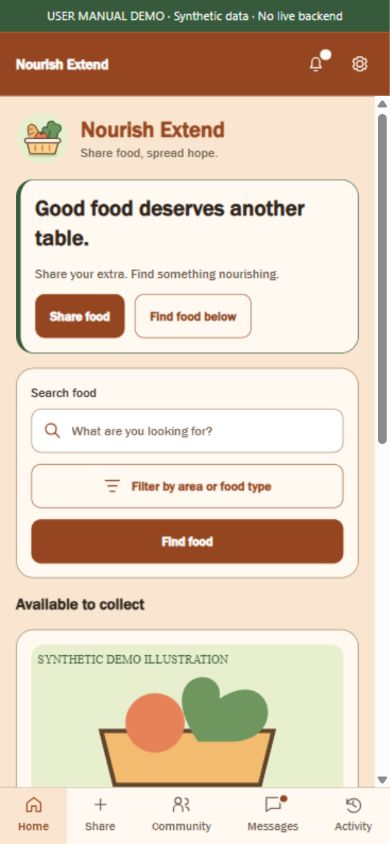
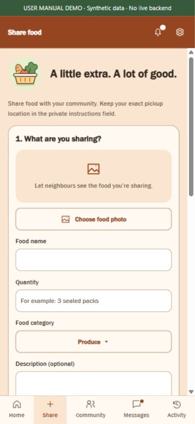
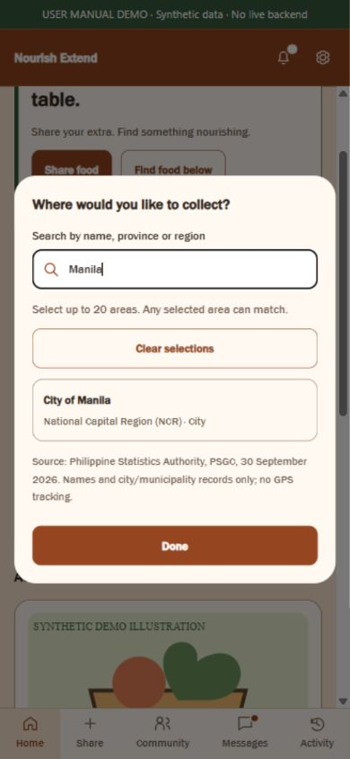
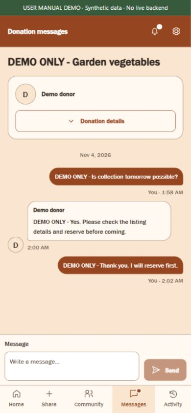
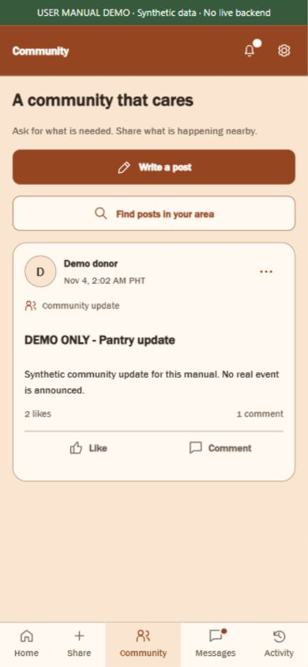
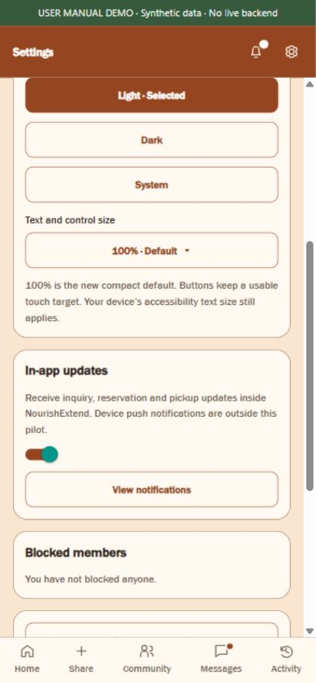

# Nourish Extend

A food donation and community app for a school project in the Philippines. Individuals and organisations can share surplus food, find donations, and arrange collection privately.

Built with **Expo, React Native, React Native Web, and Supabase** for **web and Android**.

## Features

- Food listings with photos, allergens, storage guidance, and collection deadlines.
- City/municipality search, reservations, private messages, and collection history.
- Community requests and updates, likes, comments, reporting, and blocking.
- Profiles, email/password authentication, in-app notifications, themes, and text sizing.

## Screenshots

| Home | Share food | City and municipality search |
| --- | --- | --- |
|  |  |  |

| Private messages | Community | Appearance and sizing |
| --- | --- | --- |
|  |  |  |

Actual web UI captures from version 1.2.3 (4 November 2026), using **synthetic demo data; no live backend actions**. Android system controls may differ.

## Run locally

Requirements: **Node.js 24+**, npm, and a configured Supabase project. Internet is required for shared data.

For a fresh backend, apply the SQL files in [supabase/migrations](supabase/migrations) in filename order and deploy the four [Edge Functions](supabase/functions). Enable email confirmation and custom SMTP, use the supplied [email templates](supabase/templates), and set email codes to eight digits. Existing configured projects should not reapply migrations.

From your checkout:

```sh
npm ci
npm run configure
npm run web
```

The configuration helper creates `.env` using your Supabase project URL and publishable key. If `.env` already exists, skip `configure`; see [.env.example](.env.example) for available settings. Never include secret/service-role keys in client configuration or Git.

Open the address printed by Expo, usually `http://localhost:8081`. On Windows PowerShell, use `npm.cmd` instead of `npm` if script execution is blocked.

## Build and check

```sh
npm run export:web     # Static website in dist/
npm run preview        # Preview the exported website locally
npm test               # Local automated tests
```

For a standalone Android APK on Windows, install **JDK 17** and Android SDK Command-line Tools, then run:

```sh
npm.cmd run android:setup
npm.cmd run build:apk
```

The APK is written to `exports/NourishExtend-demo.apk`; its installed name is **Nourish Extend**. Local builds do not require EAS.

## Pilot status

Organisation accounts are unverified, notifications are in-app only, and automatic retention cleanup must be configured before using real personal data. This school pilot has not undergone a complete security audit.
